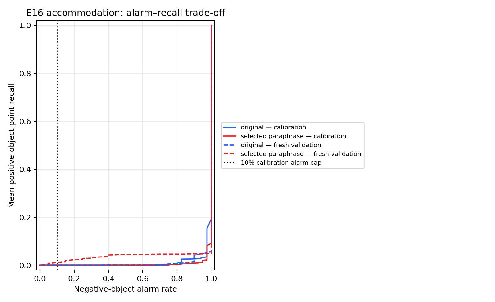

# E16: accommodation prompt under a false-alarm cap

**Status:** completed, CPU fallback. **Model:** unofficial Espresso-3D reimplementation with Affogato-pretrained weights. **Primary question:** can either locked accommodation prompt retain positive-object localization while keeping negative-object alarms at or below 10%?

## Design

We chose accommodation as the single primary affordance because E14 showed the largest prompt-related false-alarm increase for this action. The original prompt and the E13-selected paraphrase were fixed before E16. Calibration used 40 positive and 40 negative OpenAD training shapes; the original scores were reused from E15 and the paraphrase scores were computed for E16. The decision rule was fixed in advance: among thresholds with no more than 10% negative-object alarms, maximize average per-object point recall. We then froze the prompt-specific cutoff and evaluated it on 20 positive and 20 negative fresh OpenAD validation shapes. The test IDs were disjoint from E09–E14 and from calibration IDs.

A negative object counts as an alarm if any point score is at or above the cutoff. The 20+20 test is stratified by ground-truth presence and does not estimate natural prevalence. The model was not trained on OpenAD; this is exploratory cross-dataset testing, not an official Espresso or Affogato benchmark.

MPS was unavailable in this session, so E16 test predictions and paraphrase calibration predictions were computed on CPU. Original calibration scores were reused from E15, which ran on MPS. An earlier CPU–MPS check matched aggregate metrics to the reported precision, but E16 calibration was not fully same-device; treat the exact cutoff as exploratory until it can be recomputed consistently on one device.

A same-device MPS rerun was later completed on the identical E16 objects. It selected the same cutoffs, and score maps matched the CPU maps within 1×10⁻⁵. See the [MPS results](../E16_operating_point_mps/RESULTS.md) and [device comparison](../E16_operating_point_mps/DEVICE_COMPARISON.md); the mixed-device caveat above applies only to this initial CPU run.

## Main result: no useful cutoff met the 10% rule

| Prompt | Selected cutoff | Calibration positive recall | Calibration negative alarms | Test positive recall | Test negative alarms |
|---|---:|---:|---:|---:|---:|
| Original: “Point to the part of the object that can hold something.” | 1.00 | 0% | 0/40 | 0% (0/20 detected) | 0/20 |
| Selected paraphrase: “Point to the part where you would place or keep something.” | 1.00 | 0% | 0/40 | 0% (0/20 detected) | 0/20 |

Both prompts could satisfy the alarm cap only by selecting a cutoff that detected no positive test objects. Under this rule, neither prompt has a useful operating point on this data. This is a substantive negative result, not evidence that the threshold rule succeeded.

## What the scores still show

Using Espresso’s threshold-averaged aIoU on the fresh positive test objects, the selected paraphrase averaged **5.99%** versus **3.64%** for the original prompt. The paired change was **+2.35 percentage points** (object bootstrap 95% interval **+0.26 to +5.33 pp**, 20 objects). AUC remained low: **42.4%** for the paraphrase and **38.4%** for the original, both below 50% on this sample.

At the uncalibrated diagnostic cutoff of 0.5, the original flagged 1/20 positive and 4/20 negative objects; the paraphrase flagged 8/20 positive and 19/20 negative objects. Thus the paraphrase highlighted more positive objects, but also fired on nearly every negative object. The 0.5 values are descriptive only and were not used to select the E16 cutoff.

## Interpretation and next step

The selected wording gives a small improvement in threshold-averaged localization on fresh objects, but the model’s scores do not separate present from absent accommodation affordances well enough for a 10% false-alarm operating rule. The proposal should therefore frame prompt wording as a localization-versus-false-alarm trade-off, not claim that the paraphrase is uniformly better. The next experiment should retain this single primary affordance, predeclare a task-justified alarm cap with the professor, and report the full calibration and held-out alarm–recall curves. Do not choose a new cap by optimizing on the held-out test set.

## Reproducibility and artifacts

- `run.json`: prompts, train/validation object IDs, thresholds, metrics, and runtime/device metadata.
- `predictions.npz`: calibration and fresh validation score maps, GT labels, and point coordinates.
- `thresholds.csv`, `threshold_curve.csv`, `operating_curves.csv`: selected cutoffs and curves.
- `test_per_object.csv`, `summary.csv`: per-object outputs and summary metrics.
- `run_e16_operating_point.py`, `run.log`: runner and console log.
- `operating_curve.png`: calibration and test alarm–recall plot.

The initial five-affordance CPU attempt was stopped before completing held-out scoring because MPS was unavailable and inference was too slow. Its partial log and metadata are preserved separately; it is not part of the E16 result.
